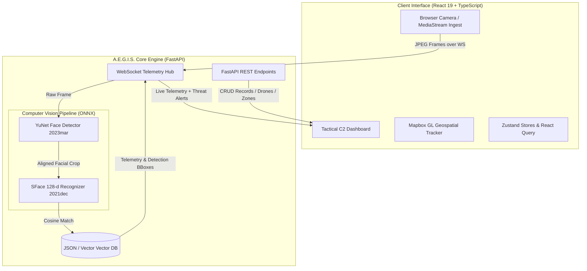

# A.E.G.I.S. — Autonomous Edge Global Intelligence System
### Next-Generation Tactical Border Surveillance & Biometric Reconnaissance Platform


---

## 🛰️ Overview

**A.E.G.I.S.** (Autonomous Edge Global Intelligence System) is a defense-grade, real-time command, control, and intelligence platform designed for border patrol operations, reconnaissance missions, and facility security.

The platform unifies multi-sensor telemetry, drone patrol tracking, tactical GIS map visualization, and real-time biometric identification powered by deep neural networks directly at the tactical edge.

---

## ⚡ Key Capabilities

- **Real-Time Video Analytics**: Client-side camera stream ingestion transmitting optimized frames to the backend AI engine over bidirectional WebSockets.
- **Biometric Identification Engine**:
  - **OpenCV YuNet DNN**: High-accuracy face detection running at 720p inference resolution with landmark alignment.
  - **OpenCV SFace DNN**: 128-dimensional facial embedding generation matched via cosine similarity against classified suspect & personnel databases.
- **Tactical Map Operations**: Mapbox GL integration displaying patrol zones, live drone flight paths, surveillance nodes, and geofence alarms.
- **Multi-Camera Grid**: Surveillance node selector with multi-angle playback and real-time bounding box visual overlays.
- **Personnel & Suspect Management**: Searchable database with biometric enrollment, image uploads, metadata profiling, and automatic vector indexing.
- **Full-Stack Cloud & Edge Ready**: Out-of-the-box support for Docker, Docker Compose, Railway, and local edge deployment.

---

## 🏗️ System Architecture



---

## 📂 Project Structure

```text
github/
├── src/                               # Frontend Source (React 19 + Vite)
│   ├── app/                           # App initialization & router
│   ├── components/                    # Global shared components (BrowserCamera, etc.)
│   ├── core/                          # Core layout (AppShell, TopNavBar)
│   ├── features/                      # Feature modules
│   │   ├── dashboard/                 # Central Operations & tactical panels
│   │   ├── multicam/                  # Multi-node surveillance feeds
│   │   ├── records/                   # Suspect & personnel registry
│   │   ├── drones/                    # Drone dispatch and telemetry
│   │   ├── playback/                  # Incident playback analysis
│   │   └── settings/                  # Hardware & stream configuration
│   ├── services/                      # WebSockets & API services
│   ├── store/                         # Zustand global state stores
│   └── types/                         # TypeScript domain contracts
├── backend/                           # Backend Source (FastAPI + OpenCV)
│   ├── app/
│   │   ├── main.py                    # REST router & WebSocket handlers
│   │   └── services/
│   │       └── camera.py              # YuNet & SFace computer vision pipeline
│   ├── data/                          # Seed databases & vector embeddings
│   ├── models/                        # Pre-trained ONNX models (YuNet & SFace)
│   ├── uploads/                       # Enrolled suspect & personnel portraits
│   ├── requirements.txt               # Backend dependencies
│   ├── Dockerfile                     # Backend container definition
│   └── .env.example                   # Backend environment template
├── docker-compose.yml                 # Multi-container local orchestration
├── Dockerfile                         # Frontend production container (Nginx)
├── launch_aegis.bat                   # 1-Click Windows Unified Launcher
├── package.json                       # Frontend dependencies & scripts
├── tsconfig.json                      # TypeScript configuration
├── vite.config.ts                     # Vite bundler configuration
└── README.md                          # Project documentation
```

---

## 🚀 Quick Start Guide

### Option 1: One-Click Launch (Windows)

Run the included automated launcher:
```cmd
launch_aegis.bat
```
This automatically initializes the backend Python virtual environment, installs dependencies, launches the FastAPI server on port `8000`, and starts the Vite development server on port `5173`.

---

### Option 2: Manual Local Setup

#### 1. Backend Setup
```bash
cd backend

# Create virtual environment
python -m venv venv

# Activate virtual environment
# Windows:
.\venv\Scripts\activate
# Linux/macOS:
source venv/bin/activate

# Install dependencies
pip install -r requirements.txt

# Configure environment variables
cp .env.example .env

# Run FastAPI server
uvicorn app.main:app --reload --host 0.0.0.0 --port 8000
```
Backend API docs will be accessible at: `http://localhost:8000/docs`

#### 2. Frontend Setup
```bash
# Return to root directory
cd ..

# Install dependencies
npm install

# Configure environment variables
cp .env.example .env

# Start Vite development server
npm run dev
```
Frontend will be accessible at: `http://localhost:5173`

---

### Option 3: Docker Compose

Spin up both services with a single command:
```bash
docker-compose up --build
```

---

## ⚙️ Environment Variables

### Frontend (`.env`)
| Variable | Description | Default |
| :--- | :--- | :--- |
| `VITE_API_URL` | Base URL of the backend REST API | `http://localhost:8000` |
| `VITE_WS_URL` | WebSocket URL for telemetry & streaming | `ws://localhost:8000/ws` |

### Backend (`backend/.env`)
| Variable | Description | Default |
| :--- | :--- | :--- |
| `CAMERA_SOURCE` | Primary ingest mode (`browser` or network stream) | `browser` |
| `CAM_MB_URL` | Optional RTSP / HTTP IP camera stream URL | `""` |
| `MIN_MATCH_CONFIDENCE` | Face verification confidence threshold | `0.80` |
| `SFACE_THRESHOLD` | Cosine similarity match threshold | `0.38` |
| `AI_SCAN_INTERVAL_FRAMES`| Frame skipping factor for inference throughput | `2` |
| `FRAME_RESIZE_SCALE` | Downscale factor for real-time processing | `0.5` |

---

## 🤖 Pre-Trained AI Models

The backend includes OpenCV-compatible ONNX models in `backend/models/`:
- **`face_detection_yunet_2023mar.onnx`** (~232 KB): Light, ultra-fast DNN face detector with 5 landmark points.
- **`face_recognition_sface_2021dec.onnx`** (~38.6 MB): SFace deep network producing 128-dimensional biometric embeddings.

---

## 📤 How to Push to Your GitHub Account

1. Open your terminal in this directory:
   ```bash
   cd github
   ```

2. Initialize a new Git repository:
   ```bash
   git init
   ```

3. Add all files (the included `.gitignore` will ensure only clean source files and assets are tracked):
   ```bash
   git add .
   ```

4. Create your initial commit:
   ```bash
   git commit -m "feat: initial commit for AEGIS Intelligence Platform"
   ```

5. Rename the default branch to `main`:
   ```bash
   git branch -M main
   ```

6. Add your GitHub remote repository:
   ```bash
   git remote add origin https://github.com/<YOUR_GITHUB_USERNAME>/<YOUR_REPOSITORY_NAME>.git
   ```

7. Push your repository:
   ```bash
   git push -u origin main
   ```

---

## 🛡️ License & Classification

Proprietary Software. Developed for edge intelligence, defense research, and automated border surveillance demonstrations.
